


 

 

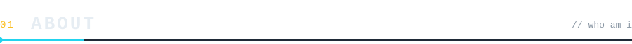


 

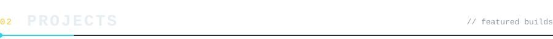

<table>
<tr>
<td width="50%"><a href="https://github.com/LeaDer-E/V-MacroPuls">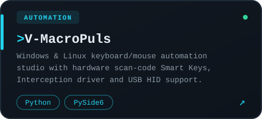</a></td>
<td width="50%"><a href="https://github.com/LeaDer-E/V-AutoKeyPresser">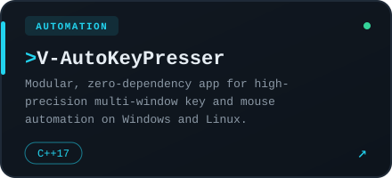</a></td>
</tr>
<tr>
<td width="50%"><a href="https://github.com/LeaDer-E/V-Stream-Downloader">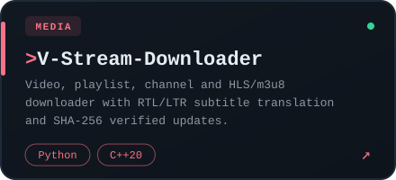</a></td>
<td width="50%"><a href="https://github.com/LeaDer-E/V-Mawaqeet">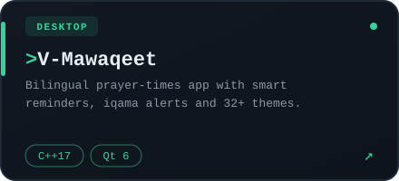</a></td>
</tr>
<tr>
<td width="50%"><a href="https://github.com/LeaDer-E/LeaDer-E-Workspace">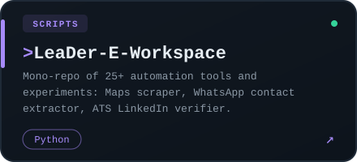</a></td>
<td width="50%"><a href="https://github.com/LeaDer-E/ResumeStudio">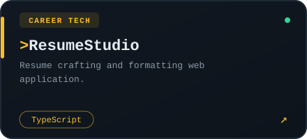</a></td>
</tr>
</table>

**Also on my profile:** [Blink-Date-Converter](https://github.com/LeaDer-E/Blink-Date-Converter) (Hijri ↔ Gregorian, C++) · [BlinkText](https://github.com/LeaDer-E/BlinkText) (text utility, C++) · [Grep-docx](https://github.com/LeaDer-E/Grep-docx) (`grep` for .docx, Python) · [AlFares](https://github.com/LeaDer-E/AlFares) (TypeScript)

  

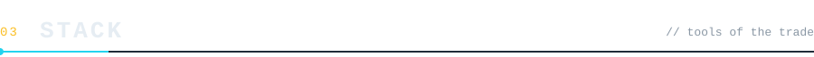

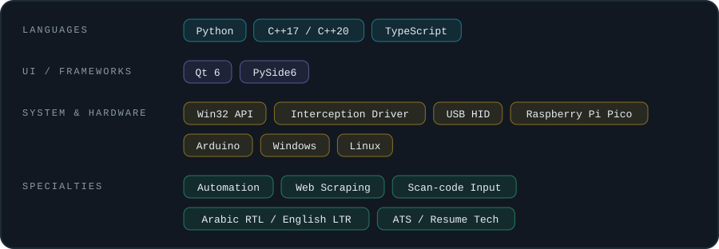

 

 

**Got a repetitive task that deserves to be automated? Let's build it.** 🌹

